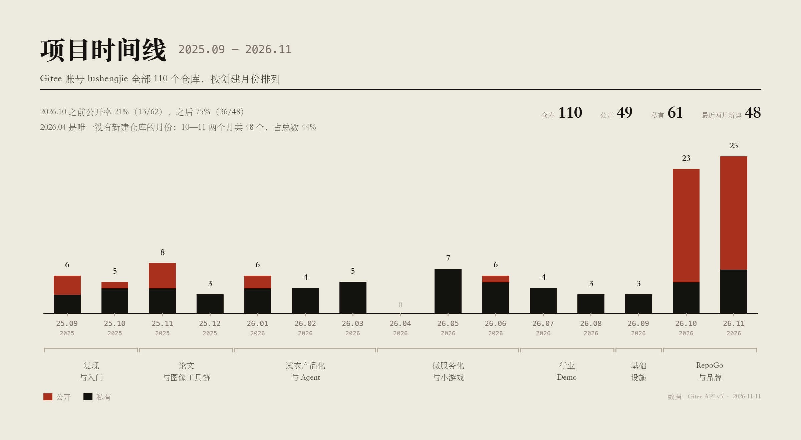

# 项目时间线 · 2025.09 — 2026.11

> 数据来源：Gitee 账号 `lushengjie` 全部 110 个仓库的创建时间与语言占比（Gitee API v5，截至 2026-11-11）。私有仓库只统计数量，不展开内容。

## 一眼看全

| 指标 | 数值 |
| --- | --- |
| 仓库总数 | 110 |
| 公开 / 私有 | 49 / 61 |
| 时间跨度 | 2025.09 — 2026.11（另有 2021.04 的 `vue_shop`，之后四年空白） |
| 峰值月 | 2026.11（25 个）、2026.10（23 个） |
| 空窗月 | 2026.04（0 个） |
| 最近两月新建 | 48 个，占总数 44% |
| 公开率转折 | 2026.10 之前 13/62（21%），之后 36/48（75%） |
| 近 30 天仍有推送 | 49 个（45%） |

## 七个阶段

### 01 · 2025.09 — 2025.10 ｜ 复现与入门

**11 个仓库，公开 4 个**　｜　主力语言：Python ×7, C++ ×2, Shell ×1

把主流开源模型往本地搬：`demo_c_ai` 用 C 复现 AI 计算，`comfui_lsj` 搭 ComfyUI，`llama.cpp`／`sam2`／`transformers`／`MMPose` 是源码级阅读和魔改，`flux_demo` 做训练与推理脚手架。几乎全是 Python + C++，仓库多而散，是典型的「先把轮子摸一遍」。

### 02 · 2025.11 — 2025.12 ｜ 论文与图像工具链

**11 个仓库，公开 4 个**　｜　主力语言：Python ×5, TeX ×3, Jupyter Notebook ×1, Shell ×1

11 月同时开两条线：一条是毕业论文（`sudasynthesis` 三兄弟，把苏州大学 LaTeX 模板本地化），一条是人体图像工具链——`densepose` 只保留出图功能、`humanparsing` 从 OOTDiffusion 里抽出 SCHP、`SuperResolution` 把 GFPGAN 包一层、`faceswap`。看着零散，其实都指向同一件事：把「人」拆成姿态、解析、换衣、清晰度几个可组合的部件。同期还有模型网关 `lsj_shenfu_modelgateway` 与 `lsj_kube`。

### 03 · 2026.01 — 2026.03 ｜ 试衣产品化与 Agent

**15 个仓库，公开 2 个**　｜　主力语言：Python ×10, HTML ×1, Dart ×1, JavaScript ×1

部件在这里拼成产品：焕影登场（`huanying_app` Flutter／`huanying_react` 网页／`huanying_app_go_service` Go 服务），第一次出现完整多端；`change_clothes` 把「生成模特—提取衣服—换衣—换姿势—换背景」串成一条 Gemini API 流水线；`lsj_algo_service`／`_pkg` 开始把算法从脚本变成服务。另一边 `lsj_metagpt_china`、`workspace_nano_agent`、`workspace_autotag` 是 Agent 的早期试水。语言里第一次出现 Dart、Go。

### 04 · 2026.05 — 2026.07 ｜ 微服务化与小游戏

**17 个仓库，公开 1 个**　｜　主力语言：Python ×14, GDScript ×1, C++ ×1, JavaScript ×1

`algo-*` 七件套在一周内建齐（common／gateway／engine／llm-router／worker／worker-biz-normal／worker-biz-agent），7 月又补 `algo-search` 与 `algo-biz-search`：从「一个服务塞所有业务」变成「网关 + 引擎 + 路由 + 按业务拆 worker」。demo 线同时推进：`demo_vton2video`（试衣出视频）、`demo-video-gen`、`demo-image-edit-platform`、`demo-multiview-extract`（三视图与服装提取）。副线开游戏：`godot-game-slime-battle`、`demo-mygame-chess-china`（Minimax + Alpha-Beta + Stockfish 引擎对战）。

### 05 · 2026.08 — 2026.09 ｜ 行业 Demo

**6 个仓库，公开 0 个**　｜　主力语言：Python ×5, HTML ×1

三个同系列 demo（`demo_zhuoyou_wenmingjiyuan`／`demo_zhuoyou_wuxia`／`demo_zhuoyou_enianlunhui`）＋ 通用 Agent（`demo_generic_agent`）＋ AI 管理系统 ＋ `shenji_infindeep`。项目数掉到 3 个/月，且全部私有——典型的「接单做 demo」节奏：不追求沉淀，追求能演示。全时间线公开率最低的一段。

### 06 · 2026.10 ｜ 基础设施与教育 Web

**23 个仓库，公开 18 个**　｜　主力语言：Python ×10, HTML ×3, JavaScript ×3, Shell ×3

一个月仓库数翻三倍，且几乎全公开。方向突然散开：`ServerPortBoard`（端口面板）、`network_trace`、`doc_convert_mcp`、`CyberHardwareDoctor`（赛博维修师）、`vm-experience-lab`（网页虚拟机体验室）、`piano-tutor-game`、`CIFEditor`、`code-friends`、`esp-labs-web`（ESP32-S3 学习站）、`crypto-paper-lab`（观潮）。同时 RepoGo 第一批（`repogo-glance`／`-ttt`／`-trivy`／`-prometheus`／`-hugo`／`-rea`／`-voxcpm2`／`-ppt-master`／`-loki`）出现。判断：从「给客户做私有系统」切换到「做能被搜到、能被别人跑起来的东西」。

### 07 · 2026.11 ｜ RepoGo 与个人品牌

**25 个仓库，公开 18 个**　｜　主力语言：Python ×12, Shell ×3, JavaScript ×3, Vue ×3

RepoGo 补齐到 20+（`lightpanda`／`impeccable`／`hallmark`／`kornia`／`worktrunk`／`scrapling`／`ollama`／`rclone`／`anime`／`it-tools`／`homer`／`ziwei-doushu`／`pptist`／`ezbookkeeping`…），统一模式是：固定上游版本 + 中文实跑手册 + 一键启动 + 排坑。自有产品同时收束：`sidewave`（副业浪潮）、`image-link-studio`（拾光，FastAPI + 阿里云 FC）、`xianyu-ops`、`job-pilot`、`dafeiyu-ai-vtuber`、`protein-chaperone-demo`、`dpsk-portable`，最后落到 `xiaolu-studio-site`（个人官网）。

## 四条变迁主线

**1. 从「跑通」到「交付」。** 2025 年的仓库是复现与魔改（`flux_demo` 式脚手架、`transformers` 源码精读）；2026 年的仓库开始带「固定版本 + 启动包 + 中文手册 + 许可说明」这类交付物，最高形态就是 RepoGo 那 20 多个。

**2. 从单体到微服务，再回到单页。** `algo-*` 是架构顶点（网关 + 引擎 + LLM 路由 + 多业务 worker）；2026.10 之后反而全是静态站小工具。这不是退步，是「给谁用」变了：前者给客户，后者给自己和陌生人。

**3. 公开率掉头。** 2026.01—09 公开率几乎为 0（客户项目）；2026.10 起一个月内 18 个公开仓库，公开率从 21% 跳到 75%。这条曲线比项目数量更能说明方向变化。

**4. 语言是三条腿。** Python 63/110 是恒定底色；Dart/Go 只出现在 2026.01—03（多端与服务化那一段）；Vue/TypeScript/Shell 集中在 2026.10 之后的交付类仓库——技术栈是跟着「交付形态」走的，不是跟着时间走的。

## 数据里的异常点

- **2021.04 的 `vue_shop`** 是唯一的「远古」仓库，之后四年没有任何新建，2025.06 的 `tool_for_shentu` 才重新起步。

- **2026.04 整月 0 个新建**，是唯一空窗；紧接着 5 月就出现 `algo-*` 七件套，像是蓄力后的集中开工。

- **2026.10—11 两个月 48 个**，占全部仓库的 44%，且其中 36 个公开。

- **110 个仓库没有一个标为 fork**：所有上游代码都是拉下来重建成新仓库再改的，Gitee 上看不到 fork 关系。

## 附录 · 按月清单

| 月份 | 数量 | 新建仓库 |
| --- | --- | --- |
| 2025-09 | 6 | `vscomp`、`demo_c_ai`、`comfui_lsj`、`llama.cpp`、`sam2`、`VT-PPO` |
| 2025-10 | 5 | `flux_demo`、`MMPose`、`overleaftoolkit`、`transformers`、`lsjlearn` |
| 2025-11 | 8 | `sudasynthesis`、`sudasynthesis2025`、`densepose`、`humanparsing`、`SuperResolution`、`demo_RL`、`sudasynthesis_lsj`、`lsj_shenfu_modelgateway` |
| 2025-12 | 3 | `IDM-VTON`、`lsj_jupyter_synthesis`、`lsj_kube` |
| 2026-01 | 6 | `faceswap`、`animate_densepose`、`IMAGDressingv1`、`lsj_algo_service`、`lsj_metagpt_china`、`change_clothes` |
| 2026-02 | 4 | `huanying_app`、`lsj_algo_service_pkg`、`huanying_react`、`lsj_utils` |
| 2026-03 | 5 | `gradio_platform_comparison`、`workspace_ninja`、`huanying_app_go_service`、`workspace_nano_agent`、`workspace_autotag` |
| 2026-04 | 0 | — |
| 2026-05 | 7 | `algo-common`、`algo-worker`、`algo-engine`、`algo-llm-router`、`algo-gateway`、`algo-worker-biz-normal`、`algo-worker-biz-agent` |
| 2026-06 | 6 | `godot-game-slime-battle`、`demo_vton2video`、`demo-image-edit-platform`、`demo-video-gen`、`demo-mygame-chess-china`、`demo-multiview-extract` |
| 2026-07 | 4 | `demo-workclo-agent`、`algo-search`、`algo-biz-search`、`wx_luludazi` |
| 2026-08 | 3 | `demo_zhuoyou_wenmingjiyuan`、`demo_zhuoyou_wuxia`、`demo_zhuoyou_enianlunhui` |
| 2026-09 | 3 | `demo_generic_agent`、`demo_ai_management_system`、`shenji_infindeep` |
| 2026-10 | 23 | `ServerPortBoard`、`doc_convert_mcp`、`network_trace`、`CyberHardwareDoctor`、`vm-experience-lab`、`piano-tutor-game`、`DailyWorld`、`CIFEditor`、`code-friends`、`esp-labs-web`、`crypto-paper-lab`、`repogo-glance`、`repogo-ttt`、`repogo-trivy`、`repogo-prometheus`、`repogo-hugo`、`repogo-rea`、`repogo-voxcpm2`、`repogo-ppt-master`、`repogo-graphify`、`repogo-compose`、`repogo-skillspector`、`repogo-loki` |
| 2026-11 | 25 | `repogo-lightpanda`、`repogo-impeccable`、`repogo-hallmark`、`repogo-vorssaint-utils`、`repogo-kornia`、`repogo-worktrunk`、`repogo-scrapling`、`repogo-ai-memory`、`repogo-hyperframes`、`repogo-ollama`、`repogo-rclone`、`repogo-anime`、`dpsk-portable`、`repogo-ezbookkeeping`、`repogo-pptist`、`repogo-ziwei-doushu`、`repogo-homer`、`repogo-it-tools`、`sidewave`、`image-link-studio`、`xianyu-ops`、`protein-chaperone-demo`、`job-pilot`、`dafeiyu-ai-vtuber`、`xiaolu-studio-site` |
